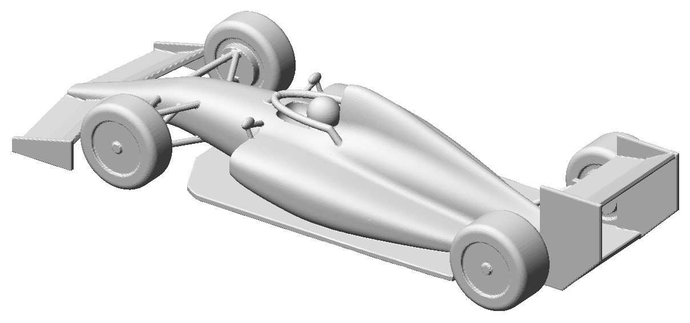
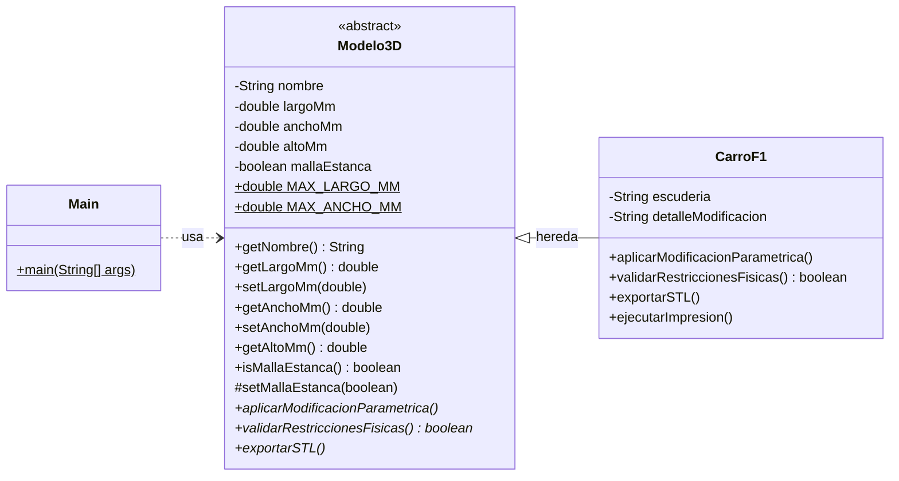
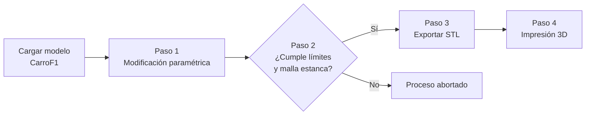
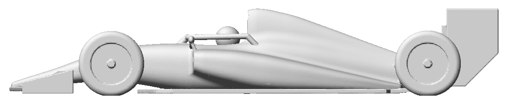

<div align="center">

# Proyecto Fundamentos de Diseño de Software
## Simulación modelo 3D

**Monoplaza de Fórmula 1 (reglamento 2026) a escala 1:43**
*Generación en Java · Formato STL · Programación Orientada a Objetos*




</div>

---

## 👥 Autores

| Integrantes |
|:--|
| Alejandro Osorio |
| Eliana Rodríguez |
| Julián Rojas |
| Joel Rubiano |
| Isabella Ruíz |

**Universidad Sergio Arboleda** · Asignatura: *Fundamentos de Diseño de Software*

---

## 📄 Descripción

Este proyecto simula el proceso de creación de un **modelo 3D de un carro de Fórmula 1** usando código en **Java** y el formato **STL** para representar el modelo. La simulación recorre las etapas de un flujo de manufactura aditiva (impresión 3D): modificación paramétrica del modelo, validación de restricciones físicas, exportación del archivo STL y envío a impresión.

El diseño del software aplica los pilares de la Programación Orientada a Objetos:

- **Sobreescritura** de métodos (`@Override`)
- **Herencia**
- **Polimorfismo**
- **Clases abstractas**
- **Encapsulamiento**

---

## 🗂️ Estructura del repositorio

```text
.
├── proyecto/                      ← Simulación desarrollada por el equipo (POO)
│   ├── Modelo3D.java              ← Clase abstracta base
│   ├── CarroF1.java               ← Clase concreta que hereda de Modelo3D
│   └── Main.java                  ← Punto de entrada de la simulación
├── modelo-ia/                     ← Modelo generado originalmente con IA
│   ├── F1Car.java                 ← Generador del STL (Java, sin dependencias)
│   └── f1_2026_escala_1-43.stl    ← Modelo 3D resultante
└── docs/                          ← Vistas previas del modelo
```

### Origen de cada parte

| Carpeta | Contenido | Origen |
|:--|:--|:--|
| [`modelo-ia/`](modelo-ia) | `F1Car.java` y `f1_2026_escala_1-43.stl` | **Generado originalmente en una conversación con un modelo de inteligencia artificial** (Claude, de Anthropic). `F1Car.java` es el programa que construye la geometría del carro y escribe el archivo STL. Se incluye como insumo del proyecto. |
| [`proyecto/`](proyecto) | `Modelo3D.java`, `CarroF1.java`, `Main.java` | **Simulación desarrollada por el equipo.** Modela, con POO, el ciclo de vida del modelo 3D: modificación, validación, exportación e impresión. |

> 💡 GitHub muestra los archivos `.stl` en un visor 3D interactivo: abre [`modelo-ia/f1_2026_escala_1-43.stl`](modelo-ia/f1_2026_escala_1-43.stl) para girar y ampliar el modelo.

---

## 🧩 Diseño de la simulación

### Diagrama de clases



### Conceptos de POO aplicados

| Concepto | Dónde se aplica | Explicación |
|:--|:--|:--|
| **Clase abstracta** | `Modelo3D` | Define qué debe hacer cualquier modelo 3D (`aplicarModificacionParametrica`, `validarRestriccionesFisicas`, `exportarSTL`) sin decir cómo. No se puede instanciar directamente. |
| **Herencia** | `CarroF1 extends Modelo3D` | `CarroF1` reutiliza los atributos y métodos comunes de `Modelo3D` y llama a su constructor con `super(...)`. |
| **Sobreescritura** | `@Override` en `CarroF1` | `CarroF1` implementa los tres métodos abstractos con el comportamiento propio de un monoplaza. |
| **Polimorfismo** | `Main` | La variable se declara como `Modelo3D` pero guarda un `CarroF1`. En tiempo de ejecución se ejecutan los métodos de `CarroF1`. Con `instanceof` y un *cast* se accede a `ejecutarImpresion()`, que solo existe en la subclase. |
| **Encapsulamiento** | `Modelo3D` y `CarroF1` | Los atributos son `private` y se accede a ellos con *getters* y *setters*. `setMallaEstanca` es `protected`, de modo que solo las subclases pueden marcar la malla como válida. Los límites de impresión son constantes `public static final`. |

```java
// Polimorfismo: referencia del tipo abstracto, objeto de la subclase
Modelo3D monoplaza = new CarroF1("Monoplaza F1 Escala", 140.0, 68.0, 28.5,
        "Equipo Ingeniería", "Nivelación de base en neumáticos y soporte trasero integrado");

monoplaza.aplicarModificacionParametrica();   // se ejecuta la versión de CarroF1
```

### Flujo de la simulación



1. **Modificación paramétrica.** Si el modelo supera el límite de **131,5 × 64,2 mm**, se reescala automáticamente y se marca la malla como estanca (cerrada).
2. **Pre-validación.** Se comprueba que las dimensiones estén dentro de los límites y que la malla sea estanca.
3. **Exportación.** Se simula la generación del archivo STL modificado.
4. **Manufactura aditiva.** Se simula el envío a la impresora 3D y el avance de la impresión.

---

## ▶️ Ejecución

**Requisitos:** JDK 8 o superior.

### Simulación (carpeta `proyecto`)

Desde la raíz del repositorio:

```bash
javac -encoding UTF-8 -d out proyecto/*.java
java -cp out proyecto.Main
```

<details>
<summary><b>Salida esperada</b></summary>

```text
==========================================================
  SISTEMA DE PRE-VALIDACIÓN Y MANUFACTURA ADITIVA (POO)
==========================================================

Modelo cargado: Monoplaza F1 Escala
Dimensiones originales: 140.0 x 68.0 mm

[Paso 1 - Modificación] Aplicando ajuste geométrico al modelo: Nivelación de base en neumáticos y soporte trasero integrado
   -> Ajustando escala automáticamente para cumplir límite compacto...
   -> Geometría cerrada (malla estanca) verificada correctamente.
[Paso 2 - Pre-validación] Verificando límites (Máx: 131.5 x 64.2 mm)...
   -> [APROBADO] Dimensiones actuales: 115.0 x 52.0 x 28.5 mm.
[Paso 3 - Exportación] Generando archivo 'Monoplaza_F1_Escala_modificado.stl'...
   -> Archivo STL exportado y listo para laminado (Slicing).

[Paso 4 - Manufactura Aditiva] Enviando archivo a la impresora 3D...
   -> Preparando cama caliente y extrusor...
   -> Realizando impresión de monoplaza (Equipo Ingeniería)...
      * Avance de impresión: 25%
      * Avance de impresión: 50%
      * Avance de impresión: 75%
      * Avance de impresión: 100%
   -> Impresión finalizada. Pieza lista para retirar de la cama.
```

</details>

### Generador del modelo STL (carpeta `modelo-ia`)

```bash
cd modelo-ia
javac F1Car.java
java F1Car                        # genera f1_2026_escala_1-43.stl
java F1Car 0.4 0.03 borrador.stl  # versión rápida de prueba (resolución, tolerancia, nombre)
```

---

## 📐 Ficha técnica del modelo STL

<div align="center">

</div>

| Parámetro | Valor |
|:--|:--|
| Escala | 1:43 |
| Dimensiones (largo × ancho × alto) | 122,23 × 44,19 × 21,86 mm |
| Límite de diseño | 131,5 × 64,2 mm |
| Referencia real | Reglamento F1 2026: batalla máx. 3400 mm, ancho máx. 1900 mm |
| Malla | 132.552 triángulos, una sola pieza cerrada (estanca) |
| Formato | STL binario, unidades en milímetros |
| Elementos | Monocasco, pontones, halo, piloto, alerones delantero y trasero, fondo plano, difusor, suspensión y neumáticos |

> El modelo es un monoplaza **genérico** con las proporciones del reglamento 2026. No reproduce el diseño ni la decoración de ninguna escudería.

---

## 🔭 Alcance y trabajo futuro

La simulación en `proyecto/` representa el flujo de trabajo con valores de ejemplo: las dimensiones de entrada se fijan en `Main` y la exportación y la impresión se muestran como mensajes en consola. Posibles extensiones:

- Leer las dimensiones reales desde el archivo STL de `modelo-ia/`.
- Conectar `exportarSTL()` con el generador `F1Car.java` para escribir el archivo modificado.
- Agregar nuevas subclases de `Modelo3D` (por ejemplo, otras categorías de vehículos) para ampliar el polimorfismo.

---

<div align="center">

**Universidad Sergio Arboleda** · Fundamentos de Diseño de Software · 2026

</div>
